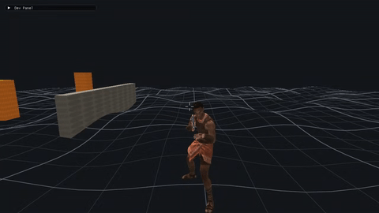
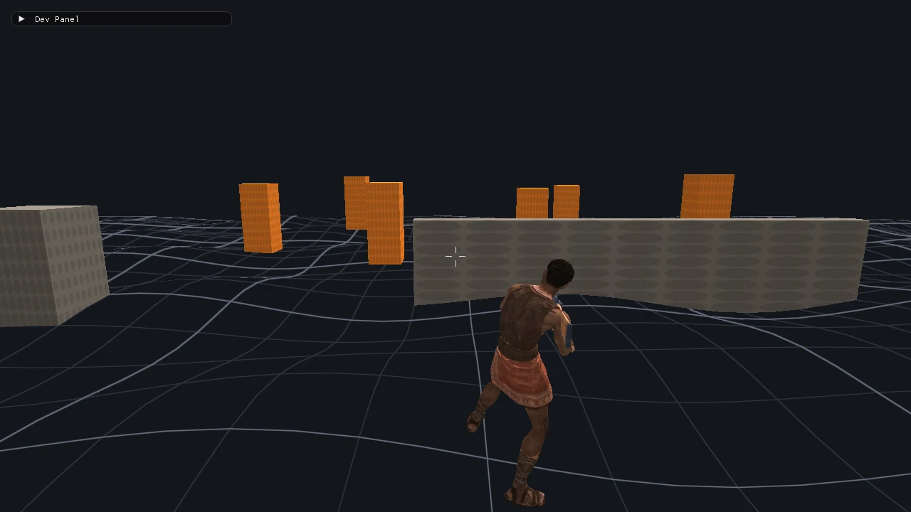
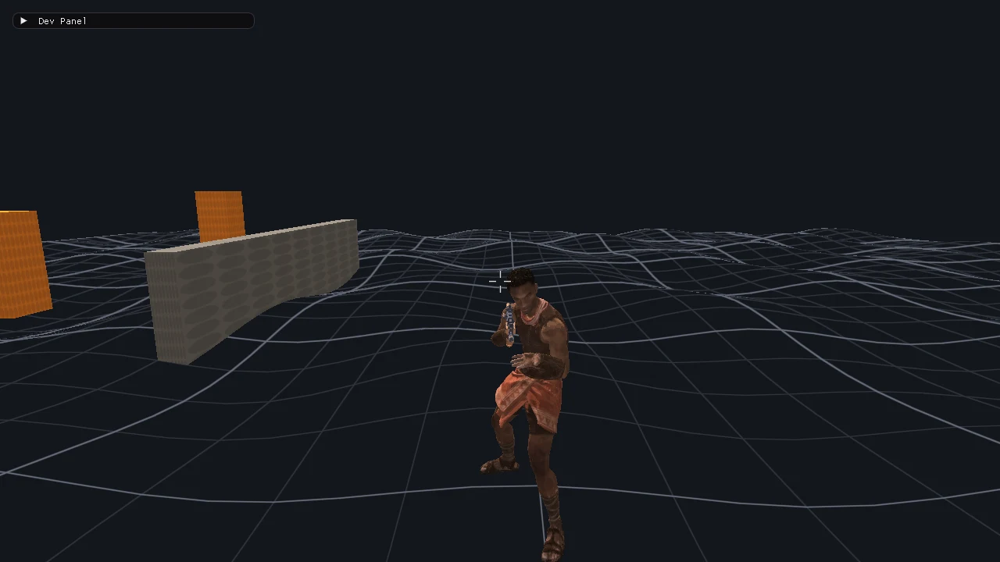

# chi-tea-aye

Minimal C++20 SDL3 game prototype.

`chi-tea-aye` is the repository codename, not necessarily the final game title.

## Preview



Gameplay video screencast:
- [docs/media/gameplay-screencast.mp4](docs/media/gameplay-screencast.mp4)





## First Milestone

- SDL3 window and main loop.
- OpenGL renders a toon-shaded cube over a ground plane.
- WASD input is tracked.
- Dear ImGui debug panel shows FPS, frame count, mouse position, and key state.
- CMake build on Linux.

## Controls

- WASD: move. Hold Shift to run.
- Mouse: click the scene to capture the pointer, then move it to look around. Esc releases it. Middle-button drag also orbits without capture; scroll to zoom. Once captured, the left button fires (hold for automatic fire) and the right button aims.
- Touch: drag the left half of the screen to move; drag the right half to orbit.
- Weapons: 1 rifle, 2 pistol, 3 fists. Three gun props float in an arc above the player's head.
- Fists: F to punch.
- Rifle: hold the right mouse button to aim from over the right shoulder. The third-person view stays zoomed out, with an X reticle and centre dot visible.
- Rifle fire: left button or Space fires, about eight rounds a second while held. Each rifle prop emits a short expanding fireball with a hot core and uneven flame edge; the shot path stays clear. Hits flash an X marker over the reticle. The reticle stays to the player's right, and shots go where it points. The player turns to face the camera while aiming or firing.
- Crouch: C toggles crouching. Crouched, the player walks slower and the view drops.
- Weapon wheel: hold Q, point at a sector (rifle top, pistol right, fists bottom or left), and release Q to pick it. Releasing in the centre picks nothing.
- The playable scene is open terrain with a ground grid; the city, parked cars, walls, and target range are absent.
- Camera: auto-recenter is off by default, so the camera keeps the angle you set. Turn it on in the dev panel to return to behind the player after orbiting.
- F1: toggle the skeleton overlay (joints and bones), which also shows the current clip.
- R: reset the warrior NPC ragdoll beside the Y-Bot player. The warrior starts in ragdoll mode and falls under gravity; player movement and the camera stay independent.

The Y-Bot player uses `assets/characters/y_bot.glb`; the warrior NPC uses
`assets/characters/african_warrior.glb`. Rifle and pistol props use
`assets/models/rifle.glb` and `assets/models/pistol.glb`; the shotgun prop is built from
geometry at runtime. The GLB files load from the working directory on desktop and are
bundled into the web build.

## Build

SDL3, Dear ImGui, and ozz-animation are git submodules. Jolt Physics 5.6.0 is fetched by
CMake during configuration. Clone with `--recurse-submodules`, or run:

```sh
git submodule update --init --recursive
```

Desktop (Linux, macOS, Windows):

```sh
cmake -S . -B build
cmake --build build
./build/chi-tea-aye
```

Web / Mobile PWA (requires Emscripten; output goes to `build-web/`):

```sh
emcmake cmake -S . -B build-web
cmake --build build-web
python3 -m http.server --directory build-web 8000
```

Open `http://localhost:8000` (or `http://<your-ip>:8000` on a mobile device on the same local network). On mobile browsers (Chrome on Android, Safari on iOS), the game can be installed to the home screen as a standalone fullscreen Progressive Web App (PWA). Touch controls are built-in: drag the left half of the screen to move, and drag the right half to orbit.

Linux desktop builds need OpenGL development headers and the usual SDL3 build dependencies (see `external/SDL/docs`).

## Layout

- `src/main.cpp`: SDL3 main callbacks only.
- `src/app`: lifecycle, frame orchestration, input events.
- `src/renderer`: OpenGL setup, shaders, and draw passes.
- `src/gameplay`: player and game state.
- `src/world`: level, terrain, and map data.
- `src/physics`: movement and collision.
- `src/assets`: asset loading and caching.
- `src/debug`: Dear ImGui debug panels (SDL3 and OpenGL3 backends).
